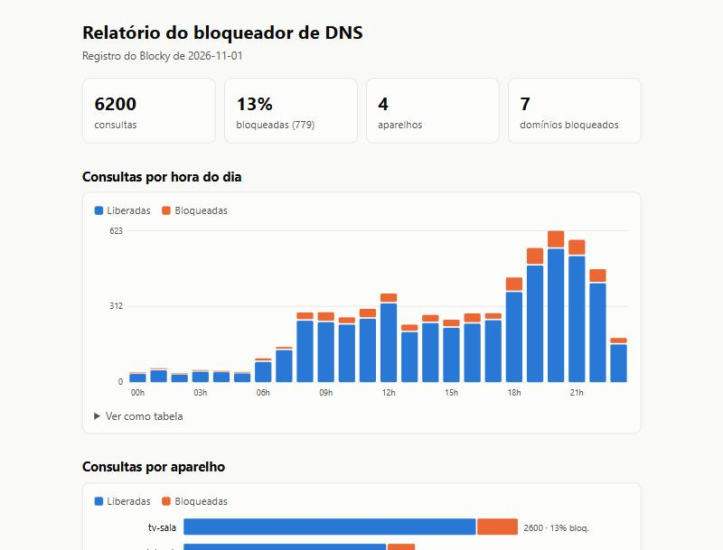

# Relatório do bloqueador de DNS

> Turns the Blocky DNS query log into a self-contained HTML report: blocked share, devices, hours of day and blocklist candidates.

[](https://github.com/ibsondiniz/relatorio-dns-blocky/actions/workflows/ci.yml)

Em casa, um celular antigo virou servidor Linux e roda o [Blocky](https://github.com/0xERR0R/blocky), um DNS que bloqueia anúncios e rastreadores para a rede toda. O Blocky grava cada consulta num CSV por dia. Esta ferramenta lê esses arquivos e gera uma página HTML única, sem dependências, com:

- total de consultas e a parcela bloqueada;
- consultas por hora do dia, liberadas e bloqueadas;
- consultas por aparelho;
- domínios mais bloqueados;
- **candidatos a bloqueio**: domínios que passaram, mas que uma lista maior (como a HaGeZi Pro++) bloquearia;
- domínios mais pedidos por aparelho.



[Veja o relatório de exemplo](docs/relatorio-exemplo.html), gerado a partir de um registro **inventado** de uma rede doméstica fictícia. Nenhum dado real de navegação está neste repositório.

## Como rodar

Só biblioteca padrão do Python, nada para instalar além do próprio pacote:

```bash
uv sync
uv run relatorio-dns exemplo exemplos/    # gera o registro inventado e uma "lista maior"
uv run relatorio-dns relatorio "exemplos/*.log" --lista exemplos/lista-maior.txt --saida relatorio.html
```

No servidor de verdade, aponte para a pasta do `queryLog` do Blocky (`type: csv`):

```bash
relatorio-dns relatorio "/srv/dns/consultas/2026-11-*_ALL.log" --lista hagezi-pro-plus.txt --saida /srv/www/dns.html
```

Com Docker:

```bash
docker build -t relatorio-dns .
docker run --rm -v "$PWD/exemplos:/dados" relatorio-dns relatorio "/dados/*.log" --saida /dados/relatorio.html
```

## Testes

```bash
uv run pytest
uv run ruff check .
```

O GitHub Actions roda os dois e constrói a imagem Docker a cada push.

## Como funciona

[COMO_FUNCIONA.md](COMO_FUNCIONA.md) explica a leitura do registro, a busca de candidatos e como os gráficos são desenhados sem biblioteca.

## Autoria

Feito por Ibson Diniz com auxílio do Claude Code, a IA de programação da Anthropic. A versão original roda todo dia no meu servidor caseiro; esta é a versão pública, com gráficos e dados de exemplo.

Licença [MIT](LICENSE).
